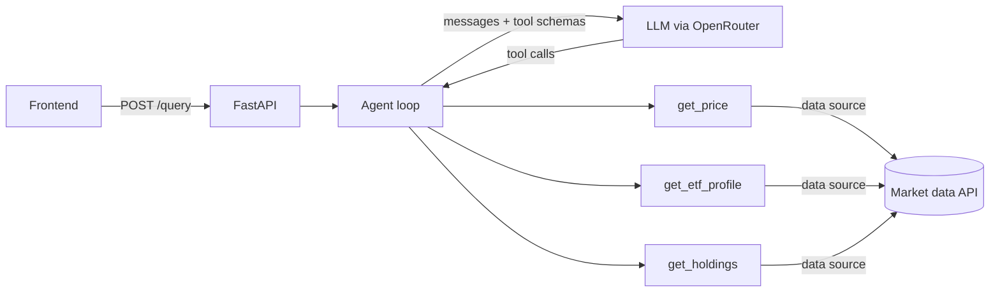

# Stock & ETF Agent

An LLM agent that answers stock and ETF questions by calling live data tools
instead of guessing. Built with FastAPI and OpenRouter.

## Features
- Tool calling: latest price, ETF profile (fees, provider, etc.), top holdings
- Scoped to stocks/ETFs; politely refuses unrelated questions
- Multi-turn chat with history, capped tool-loop iterations
- Structured action logging

## Architecture


## Quick start
```bash
git clone https://github.com/NitinSatishbabu/Stock-ETF-Agent
cd Stock-ETF-Agent
cp .env.example .env        # add your OpenRouter key
pip install -r requirements.txt
uvicorn main:app --reload
```
Or with Docker: `docker build -t stock-etf-agent . && docker run -p 8000:8000 --env-file .env stock-etf-agent`
